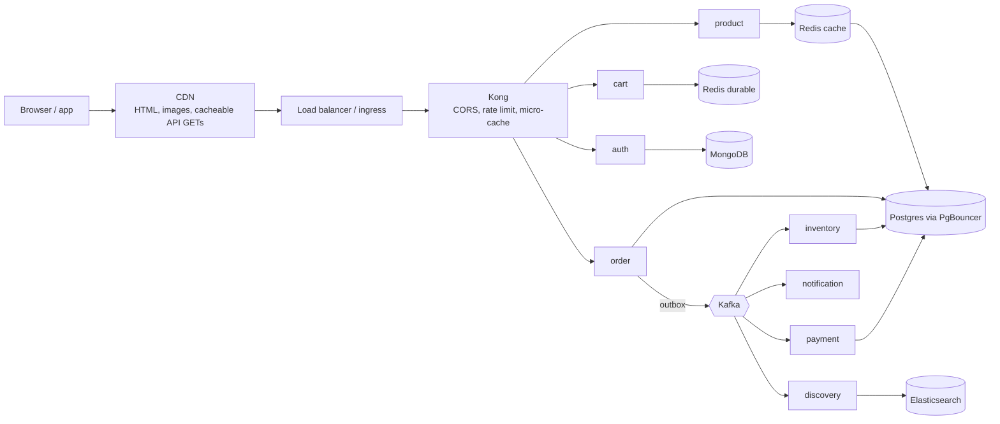

# Scaling ShopOS to ~1M concurrent users, cheaply

This is how the platform is meant to run at peak, what each layer is sized for,
and where the money goes. **Every number here is an estimate from stated
assumptions** — validate it with `loadtest/storefront.js` before you rely on it.

---

## 1. What "1M concurrent users" actually means

Concurrent users are open sessions, not requests. Assumptions (change them and
redo the arithmetic for your traffic):

| Assumption | Value |
|---|---|
| Page view per active user | 1 every ~20 s |
| API calls per page view | ~3 |
| Share of API calls that are public, cacheable reads (catalog, search, reviews) | ~80% |
| CDN hit ratio on cacheable reads (`s-maxage` + `stale-while-revalidate`) | ~90% |
| Peak orders (flash sale) | ~1,000 / s |

That gives, at the **edge**: ~50k page views/s → ~150k API req/s + HTML.

What reaches the **origin** after the CDN:

| Traffic | Origin req/s | Served by |
|---|---|---|
| Cacheable reads that miss the CDN | ~12k | Kong micro-cache → Redis → Postgres/ES |
| Personalised (cart, auth refresh, profile, orders) | ~30k | Services (cart is Redis-only) |
| Product page HTML misses | low | Next.js ISR (one render per product per minute) |

**The CDN is the single biggest cost lever.** Without it, the origin has to
serve roughly 10× more requests, and you pay for 10× more compute.

## 2. Request path

## 3. What was changed to make this possible

| Problem found | Fix | Why it matters at scale |
|---|---|---|
| Each auth replica generated its own key and random `kid`; JWKS wrapped in `{success,data}` | Shared key (required in prod), deterministic `kid`, raw JWKS, key rotation support | Auth could not run >1 replica; nothing could verify tokens |
| Every request hit Postgres for products | Redis read-through cache, single-flight, negative caching, CDN `Cache-Control`, Kong proxy-cache, ISR product pages | Catalog reads are ~80% of traffic |
| Offset-less "take 100" listing | Keyset (cursor) pagination with matching indexes | Constant cost at any page depth |
| Cart opened a Redis connection per request, panicked on errors | One multiplexed `ConnectionManager`, 503 instead of panic | Connection storms took Redis down |
| Review service created a Kafka producer per request | One long-lived producer per process | TCP + metadata handshake per write |
| Order saved, then Kafka send (dual write) | Transactional outbox + `SKIP LOCKED` relay | No lost/phantom orders when pods die |
| Order numbers: 9,000 possible per day | 50 random bits per day | Collisions within minutes at peak |
| Saga never updated order status; no failure event; no stock commit | Conditional-transition state machine, `inventory.failed`, `order.confirmed` → stock commit, timeout sweeper, refund path | Correctness under redelivery and partial failure |
| Payment: hard-coded ₹100, no idempotency | Server-priced amount, `UNIQUE(order_id)`, Stripe idempotency keys, signed webhook | Redelivery = double charge |
| Client sent prices, totals and `userId` | Server-side pricing; identity from JWT everywhere | Price tampering / acting as other users |
| Sorted-set rate limiter (4 commands/request) | 1 Lua round trip, O(1) memory, keyed by user when known | Fair to CGNAT users, cheap Redis |
| Helm readiness path `"/ready\""`; missing `/ready` endpoints; default-deny blocked service→service | Fixed probes, dependency-aware readiness, graceful drain, PDBs, spread, HPA behaviour | Pods never became ready / deploys dropped traffic |
| Kafka + ZooKeeper | Kafka KRaft | One fewer cluster to run |
| `prisma db push` on every pod start | Migration job (hook) | N pods racing schema changes |

## 4. Sizing at peak (starting point — verify with the load test)

Throughput rules of thumb used below: Node/Express serving from Redis ≈ 1.5–3k
req/s per vCPU; Rust/axum + Redis is Redis-bound; Kong ≈ 5–10k req/s per vCPU
with plugins; bcrypt (cost 11) ≈ 100 ms CPU per login.

| Component | Peak load | Approx. size at peak | Notes |
|---|---|---|---|
| CDN | ~150k req/s | managed | Cache rules for `/api/v1/products*`, `/api/v1/search*`, `/api/v1/reviews*`, `/products/*` HTML, honour origin `Cache-Control` |
| Kong | ~45k req/s | 8–12 vCPU | stateless, HPA |
| product-service | ~6k req/s past caches | 4–8 vCPU | |
| cart-service | ~15k req/s | 2–4 vCPU | Redis-bound |
| auth-service | ~1k refresh/s + login bursts | 10–60 vCPU | **logins are the CPU hog**; long-lived refresh tokens keep most users from re-logging in |
| order / inventory / payment | ~1k orders/s | 8–16 vCPU total | bounded by Kafka partitions (24 in prod) |
| Postgres primary | ~15–20k writes/s at 1k orders/s | 16–32 vCPU, NVMe | + 1–2 replicas for failover; PgBouncer in front |
| Redis | ~100k ops/s | 2 instances | split **cache** (`allkeys-lru`) from **durable** carts (`noeviction`, AOF) |
| Kafka | ~10k msg/s | 3 brokers × 4 vCPU | replication 3, `min.insync.replicas=2` |
| Elasticsearch | search misses past CDN | 3 × 8 GB | |

Rough total: **~150–250 vCPU at peak, ~40–80 vCPU baseline.** HPA scales between them, so you pay for the peak only while it lasts.

## 5. The cheap way to run it

Principles: buy bandwidth and CPU where they're cheapest, keep everything stateless except a few datastores, and let caches do the work.

1. **CDN + DDoS:** put Cloudflare (free or Pro plan) in front of both the storefront and the API. Add Cache Rules so JSON GETs are cached according to the origin's `Cache-Control`.
2. **Images:** use Cloudflare R2 (no egress fees) or Backblaze B2 behind the CDN. Set `S3_ENDPOINT`; the code already speaks S3. Images are typically the largest egress line item.
3. **Compute:** run Kubernetes on a budget provider, either managed k8s with a free control plane or k3s on VMs/dedicated servers. Budget providers usually cost a fraction of hyperscaler on-demand prices for the same vCPU and RAM. Run stateless pods on spot/preemptible nodes where available. Every service already tolerates being killed (graceful drain, idempotent consumers, outbox).
4. **Datastores, self-hosted with free operators:**
   - Postgres: CloudNativePG (primary + replica + backups to R2/B2) with PgBouncer.
   - Kafka: Strimzi in KRaft mode (or Redpanda).
   - Redis: Valkey or Redis OSS.
   - MongoDB: Community Operator.
   - Search: ECK (basic tier is free) or OpenSearch.

   If nobody on the team can operate Postgres, pay for managed Postgres only, since it's the one stateful piece where mistakes hurt most.
5. **Email:** use Amazon SES via SMTP (`SMTP_HOST`), which is usually the cheapest at volume.
6. **Payments:** Stripe or Razorpay. Fees are per transaction, with no fixed infrastructure cost.
7. **Observability:** self-host Prometheus, Grafana and Loki (`docker-compose.observability.yml`). Per-request access logs are off by default because at 50k req/s they cost more to store than they are worth; use metrics instead.
8. **AI help:** any OpenAI-compatible endpoint works (`OPENAI_BASE_URL`, `AI_MODEL`), including a self-hosted model. Calls are rate-limited per user, and with nothing configured the service costs $0.

## 6. Rollout checklist

1. `make jwt-key` → store `JWT_PRIVATE_KEY` in your secret store. Fill `infrastructure/k8s/secrets/secrets.example.yaml`.
2. Datastores up (operators), then `make db-migrate DATABASE_URL=…` once (shared schema + Prisma).
3. `kubectl -n shopos create configmap kong-declarative --from-file=kong.yml=kong/kong.yml`, then install Kong with `infrastructure/helm/kong-values.yaml`. Put your storefront origin in the `cors` plugin first.
4. `helm upgrade --install shopos infrastructure/helm/shopos -f values.yaml -f values-production.yaml --set global.imageTag=<sha>`. Hook jobs create Kafka topics and run Prisma migrations before pods roll.
5. CDN: proxy the API hostname, add the cache rules, and verify that `cf-cache-status: HIT` shows up on product GETs.
6. Load test in steps: 1k → 10k → 50k req/s (`loadtest/storefront.js`, distributed with k6-operator). After each step, check p99 latency, HPA replica counts, the Postgres CPU and connection counts, Kafka consumer lag, and Redis memory.
7. Set `PAYMENT_MODE=stripe` with webhook secret configured; mock payments are refused in production.

## 7. Known limits and next steps

Honest list of what this design does **not** solve yet:

- **Not load-tested yet.** All sizing above is arithmetic. Run the load test.
- **Write ceiling is one Postgres primary.** It's fine to roughly 10–20k writes/s on good hardware. Beyond that, partition `orders` by user or move to Citus.
- **Hot-SKU flash sales** serialise on a single `inventory` row. That's correct (no overselling), but throughput for one SKU is limited. The next step is pre-allocating stock tokens in Redis.
- **Stripe client confirmation UI is not built.** The backend returns the client secret (`GET /api/v1/payments/{orderId}`) and handles webhooks, but the checkout page still assumes mock mode.
- **Price-drop emails** need a wishlist → user fan-out job. The event is published, but nobody consumes it for email yet.
- **Single region.** Multi-region active/active needs data replication decisions that are out of scope here.
- **Three databases (Postgres, MongoDB, Elasticsearch) mean three things to operate.** Moving auth and user data into Postgres would cut operational cost.
